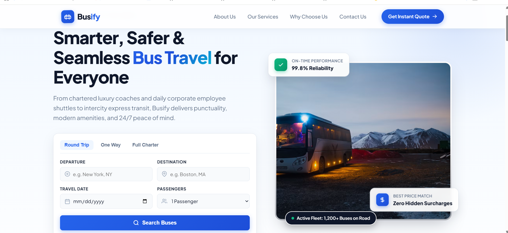

# Busify — React App

A frontend-only single-page marketing site for **Busify**, a luxury bus charter and
group transportation service. It includes a hero booking search, filterable service
cards, an about/why-choose-us section, a quote request form, and a newsletter footer.

There is **no backend, database, or API layer** in this project — all forms are
handled client-side with local state.


## Tech Stack

### Core

| Area                    | Technology                          | Version |
| ----------------------- | ----------------------------------- | ------- |
| UI library              | **React**                           | ^19.3.1 |
| DOM renderer            | **React DOM**                       | ^19.3.1 |
| Language                | **JavaScript (ES Modules, JSX)**    | —       |
| Build tool / dev server | **Vite**                            | ^8.3.5  |
| React plugin for Vite   | **@vitejs/plugin-react** (uses Oxc) | ^6.1.2  |

No TypeScript — the project uses plain JavaScript with `"type": "module"`.

### Styling

- **Plain CSS** with per-component stylesheets: `App.css`, `HomePage.css`, `Menu.css`
- **Google Fonts**: Plus Jakarta Sans + Inter (loaded in `index.html`)
- No Tailwind, CSS-in-JS, or preprocessor (Sass/Less) installed

### Code Quality

| Tool                          | Version  |
| ----------------------------- | -------- |
| **ESLint** (flat config)      | ^10.13.0 |
| `@eslint/js` recommended      | ^10.0.1  |
| `eslint-plugin-react-hooks`   | ^7.1.1   |
| `eslint-plugin-react-refresh` | ^0.5.7   |
| `globals` (browser globals)   | ^17.13.0 |

### Not Used

- No router (`react-router`)
- No state management library (Redux, Zustand, etc.)
- No data-fetching library (Axios, TanStack Query, etc.)
- No test framework configured

## Project Structure

```
react-app-project/
├── public/               # Static assets (favicon, etc.)
├── src/
│   ├── main.jsx          # React entry point
│   ├── App.jsx           # Root component
│   ├── App.css
│   ├── HomePage.jsx      # Main landing page (hero, services, about, contact, footer)
│   ├── HomePage.css
│   ├── Menu.jsx          # Responsive navigation bar
│   └── Menu.css
├── index.html            # HTML shell + Google Fonts
├── vite.config.js        # Vite config with React plugin
├── eslint.config.js      # ESLint flat config
└── package.json
```

### Architecture

`index.html` → `src/main.jsx` → `src/App.jsx` → `src/HomePage.jsx` (with `Menu.jsx` as a child component).

Component-based, with co-located CSS files and UI driven by React `useState` hooks.

## Getting Started

### Prerequisites

- Node.js 20.19+ or 22.12+ (required by Vite 8)
- npm

### Install

```bash
npm install
```

### Scripts

```bash
npm run dev      # Start the Vite dev server with HMR
npm run build    # Build for production into dist/
npm run preview  # Preview the production build locally
npm run lint     # Run ESLint over the project
```

## Features

- Responsive sticky navigation with mobile hamburger menu
- Hero booking search widget (trip type, route, date, passenger count)
- Filterable services grid (charter, corporate, transfers, luxury)
- "Why choose us" fleet amenities banner
- Quote request form with client-side validation and success state
- Newsletter signup and full site footer
